<div align="center">

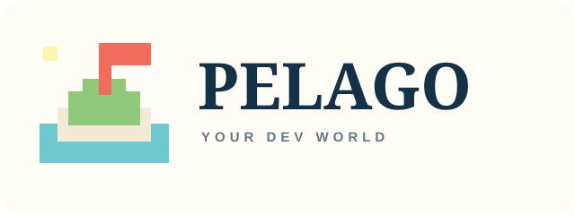

# Everything you built with AI became a place.

**Pelago turns your Claude Code and Codex history into a living pixel-art archipelago.**<br>
Every project is an island, built from the work itself. Then it tells you who you are as a builder.

<br>

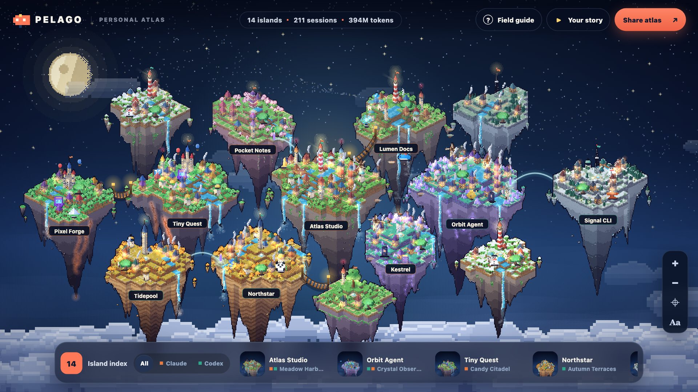

<br>

**[⚡ Get yours in one prompt](#-get-yours-in-one-prompt)** &nbsp;·&nbsp; **[🏝️ How islands grow](#️-every-island-is-built-from-your-work)** &nbsp;·&nbsp; **[💎 Relics](#-31-relics-to-find)** &nbsp;·&nbsp; **[🎬 Your story](#-your-story-and-your-card)** &nbsp;·&nbsp; **[🔒 Privacy](#-private-by-design)**

</div>

<br>

## ⚡ Get yours in one prompt

Open a new session in **Claude Code** or **Codex**, paste this, and wait about a minute:

```text
Build my Pelago world from my local AI coding history.

1. Get the Pelago skill from https://github.com/Mikebouskila/pelago:
   - Claude Code: clone it to ~/.claude/skills/pelago
   - Codex: clone it to ~/.codex/skills/pelago
   If that folder already exists, run `git pull` in it instead.
2. Run its generator with Python 3 (standard library only, nothing to install):
   python3 <skill folder>/scripts/pelago.py --output ./pelago-world.html --open
   It only reads ~/.claude/projects and ~/.codex/sessions. If you need permission
   to read those two folders, ask me for read access to just them.
3. When it finishes, tell me in a few lines: my archetype, how many islands,
   my capital island, and how many relics I found (and the rarest one).
   Don't quote or summarise any of my prompts or code.
4. Tell me to open pelago-world.html and press "Play your story".
```

That's it. Everything runs on your machine, nothing is uploaded, and the page works offline.

<details>
<summary><b>Prefer to install it yourself?</b></summary>

<br>

```bash
git clone https://github.com/Mikebouskila/pelago ~/.claude/skills/pelago   # Claude Code
git clone https://github.com/Mikebouskila/pelago ~/.codex/skills/pelago    # Codex
```

Then ask your agent for *"my AI coding wrapped"* or *"my Pelago world"*.

No agent at all? Python 3.9+ is enough:

```bash
python3 scripts/pelago.py --open          # your world
python3 scripts/pelago.py --demo --open   # a sample world, reads nothing
```

</details>

<br>

## 🏝️ Every island is built from your work

<div align="center">
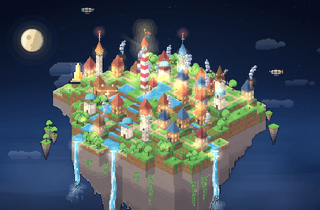
</div>

<br>

No two islands are alike, because no two projects are. And they're alive: waterfalls pour, chimneys smoke, windmills turn, lighthouses sweep the night.

| Your work | Becomes |
|---|---|
| **Tokens** | Land. The island grows, and gains another waterfall, with every 10× more tokens. |
| **Sessions** | Buildings, one per session. Longer sessions build taller. |
| **Requests you typed** | Trees, gathered into groves. |
| **Tools your agent used** | Architecture: forges for shell, workshops for edits, libraries for reading, signal towers for the web, windmills for subagents. |
| **Kind of project** | The biome and the landmark at its heart: a lighthouse for web, an observatory for AI, a clock tower for data, a radio mast for CLIs, a pagoda for mobile, a castle with balloons for games. |
| **Subagents** | Airships circling overhead. |
| **Recency** | Fresh work glows with beacons and fireflies. Islands you left alone for two months get snow. |
| **Claude Code / Codex** | Coral and sea-green flags. Built with both? One island, both flags. |

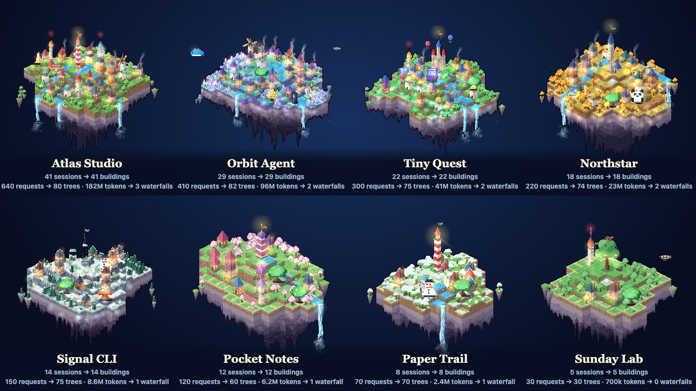

Your capital sits at the heart, related projects cluster as families, rope bridges join projects nested in each other's folders, and a golden route threads every island in the order you founded them. Filter to just Claude Code or just Codex and the archipelago re-forms around what's left.

<br>

## 💎 31 relics to find

What you built leaves treasures behind. Each relic stands on the island that earned it, glowing in its rarity colour. **Click one to see exactly why it's there.**

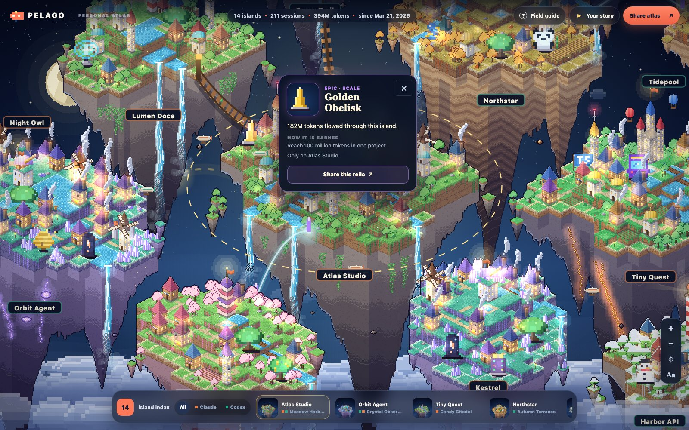

| | |
|---|---|
| 🛠️ **Craft** | Atom Orrery for React, Cargo Whale for Docker, Serpent Idol for Python, Rusted Anvil for Rust, Treasure Chest for payments, Switchboard Totem for MCP, Arcade Cabinet for game engines, and more |
| 📈 **Scale** | Golden Obelisk at 100M tokens, **👑 Titan's Crown** at a billion, Marathon Hourglass for a 1,000-message session, Great Bell at 100 sessions |
| 🧰 **Tools** | Beehive for heavy subagent use, Lightning Rod for 2,000 shell commands, Master's Hammer for 1,000 edits, Compass Rose for using every kind of tool |
| ⏳ **Crew & time** | Twin Arch when both agents built together, Ancient Oak for a 60-day project, Seedling for something new this week, Sleeping Snowman for one that's resting |

Common, Rare, Epic, Legendary. The **Field Guide** explains every symbol on the map and shows your whole collection, including what it takes to unlock the ones you're missing.

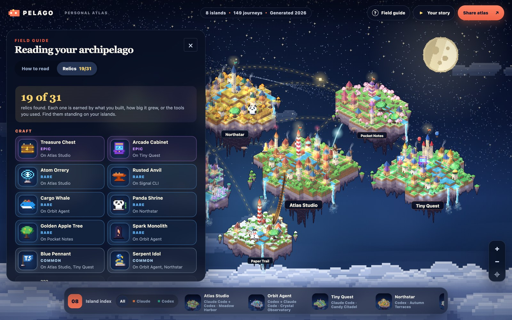

<br>

## 🎬 Your story and your card

<table>
<tr>
<td width="34%" valign="top">
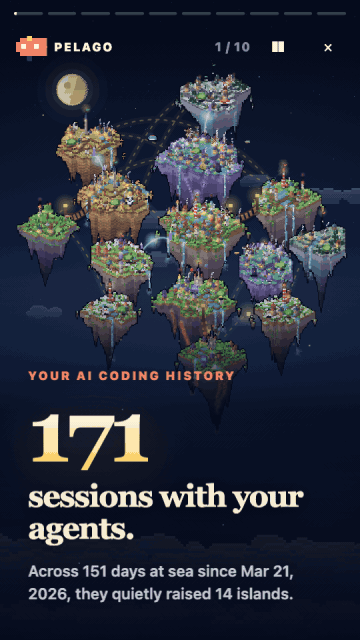
</td>
<td valign="top">

Press **▶ Play your story** for a nine-slide recap filmed over your own world. The camera flies from the whole archipelago down to your capital and back while it shows:

- how many sessions you've had with your agents
- your **capital**, and how much of everything you built lives there
- how many **tokens** flowed through, and how much was cached context
- a 24-hour clock of **when you build**
- a calendar of your **longest streak**
- how you split work between **Claude Code and Codex**
- your **relics**, rarest first
- your **archetype**

It ends on your share card. Story, Square, X/LinkedIn and GitHub sizes, one tap to share, copy or post.

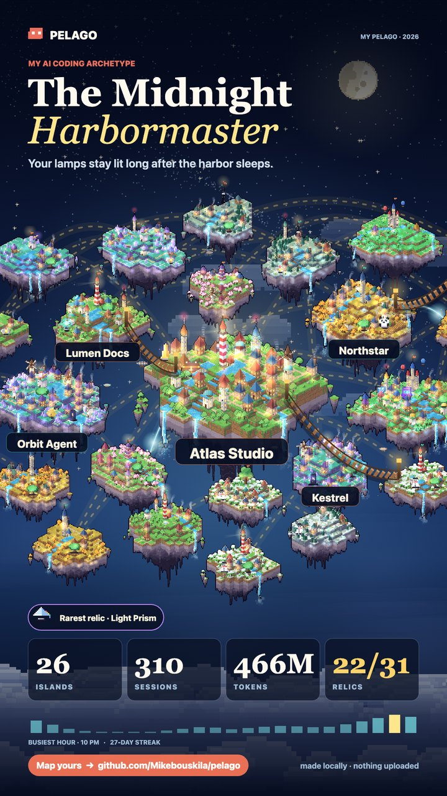&nbsp;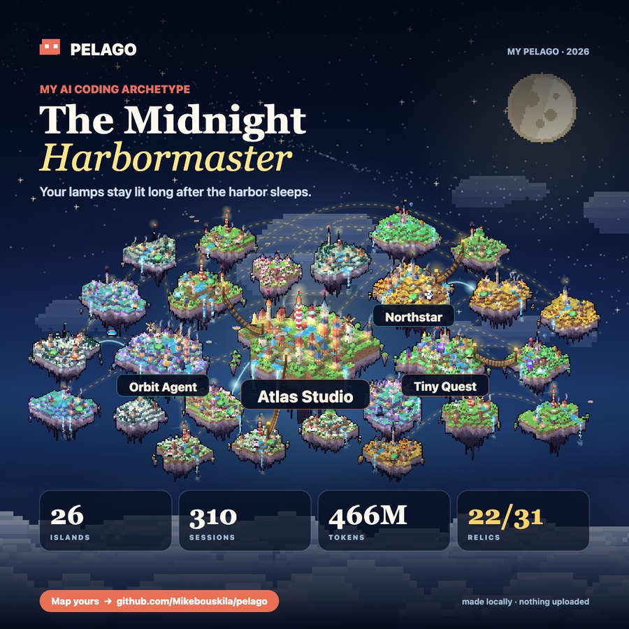

</td>
</tr>
</table>

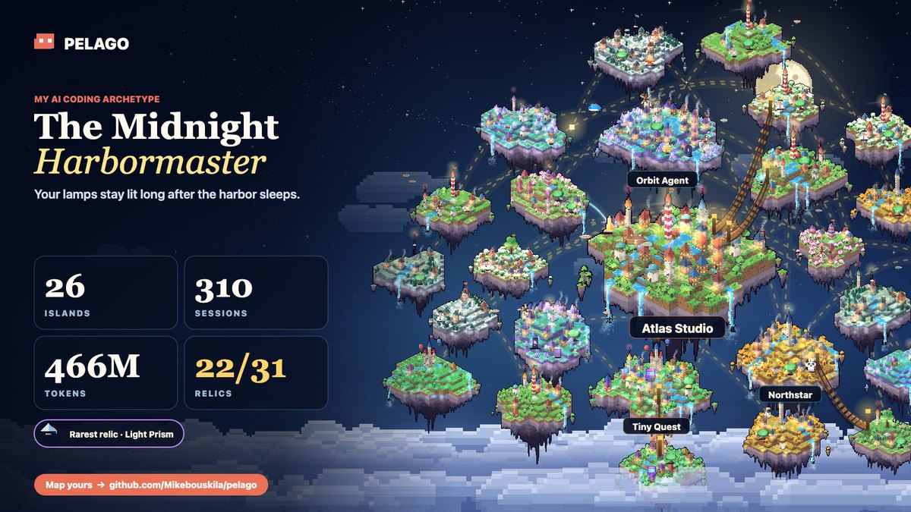

<br>

## 🧭 Which one are you?

Your archetype is earned from your real rhythm and project mix. The title comes from what you build most:

| You build… | Title |
|---|---|
| 🏝️ web, everything people arrive at | **Harbormaster** |
| 🌸 mobile apps | **Gardener** |
| 🔭 agents and AI tools | **Stargazer** |
| ⚒️ CLIs and dev tools | **Toolsmith** |
| 📚 data, analysis, notebooks | **Archivist** |
| 🏰 games | **Castle Builder** |
| 🧭 something no category fits | **Wayfinder** |
| 🗺️ a bit of everything | **Cartographer** |

The first word comes from how you build: **Midnight** (a lot after 10 PM), **Dawn**, **Weekend**, **Two-Tide** (real work with both agents), **Unbroken** (a 30-day streak), **Hive** (heavy subagent use), **Wandering** (many projects, no favourite), or otherwise the part of the day you build in: **Morning**, **Sunlit** or **Twilight**.

80 combinations. Post yours with **#pelago**.

<br>

## 📱 Made for your phone too

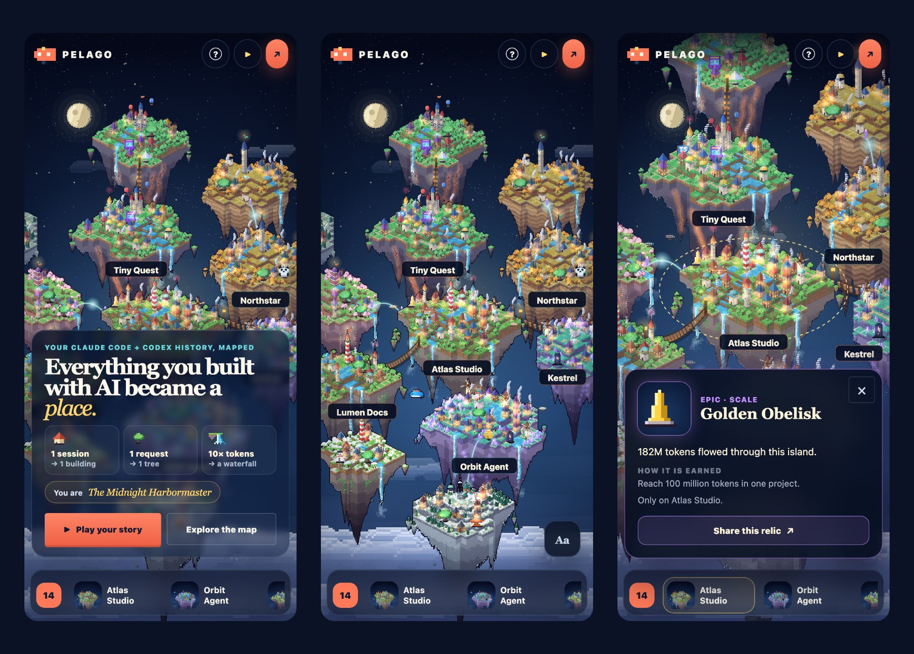

<br>

## 🔢 Every number is real

Pelago counts from your transcripts, never estimates:

- **Sessions** are conversations. Subagent threads fold into the session that launched them.
- **Requests** are only what you typed. Subagent briefs, system notices and summaries don't count.
- **Tokens** are summed from usage records, each reply billed once.
- Every line of every transcript is read, however large.
- Only what's on this computer counts. Claude Code and Codex clean up old transcripts over time, so totals can be lower than a billing dashboard. The page shows the date your history starts from.

The test suite pins each of these rules against records shaped like real transcripts.

<br>

## 🔒 Private by design

- Reads only `~/.claude/projects` and `~/.codex/sessions`.
- No network requests, no uploads. Every island is drawn in your browser from the numbers.
- Message text is read in memory to guess each project's realm, then forgotten.
- The page keeps only aggregates: project names, dates, counts, token totals, tool categories, hour and weekday totals, and how often a fixed list of 17 technologies came up.
- Sharing a card? Untick **Show project names** if any are confidential.

Pelago describes a footprint, not a score. A small island isn't a worse project, and nothing ranks you against anyone.

<br>

## 🛠️ Flags and development

```bash
python3 scripts/pelago.py --since-days 30 --open     # your month
python3 scripts/pelago.py --since-days 365 --open    # your year
python3 scripts/pelago.py --json-output pelago.json  # keep the aggregates
python3 scripts/pelago.py --input pelago.json        # rebuild from them

python3 -m unittest discover -s tests -v             # run the tests
```

The generator is `scripts/pelago.py` (standard library only). The page is `assets/world-template.html`, `world.css`, `island.js` (the procedural island generator), `relics.js` and `world.js`, inlined into one file at build time.

<div align="center">
<br>

MIT licensed · Made with Claude Code

</div>
