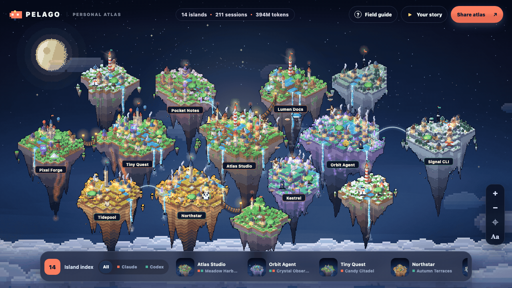
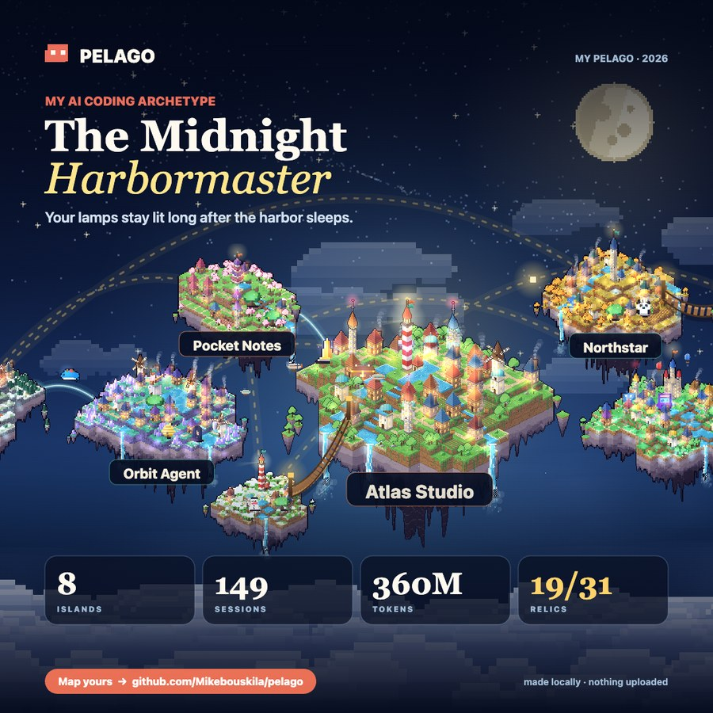
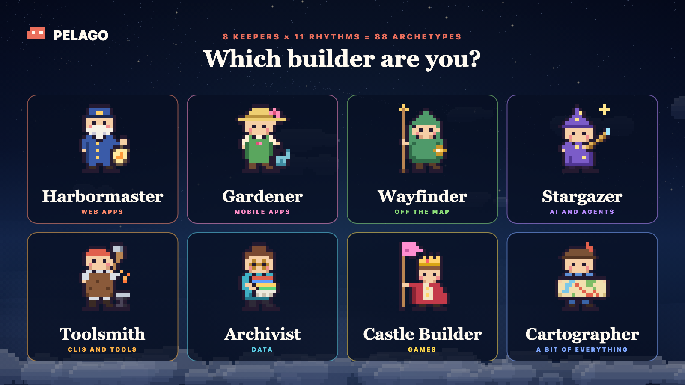
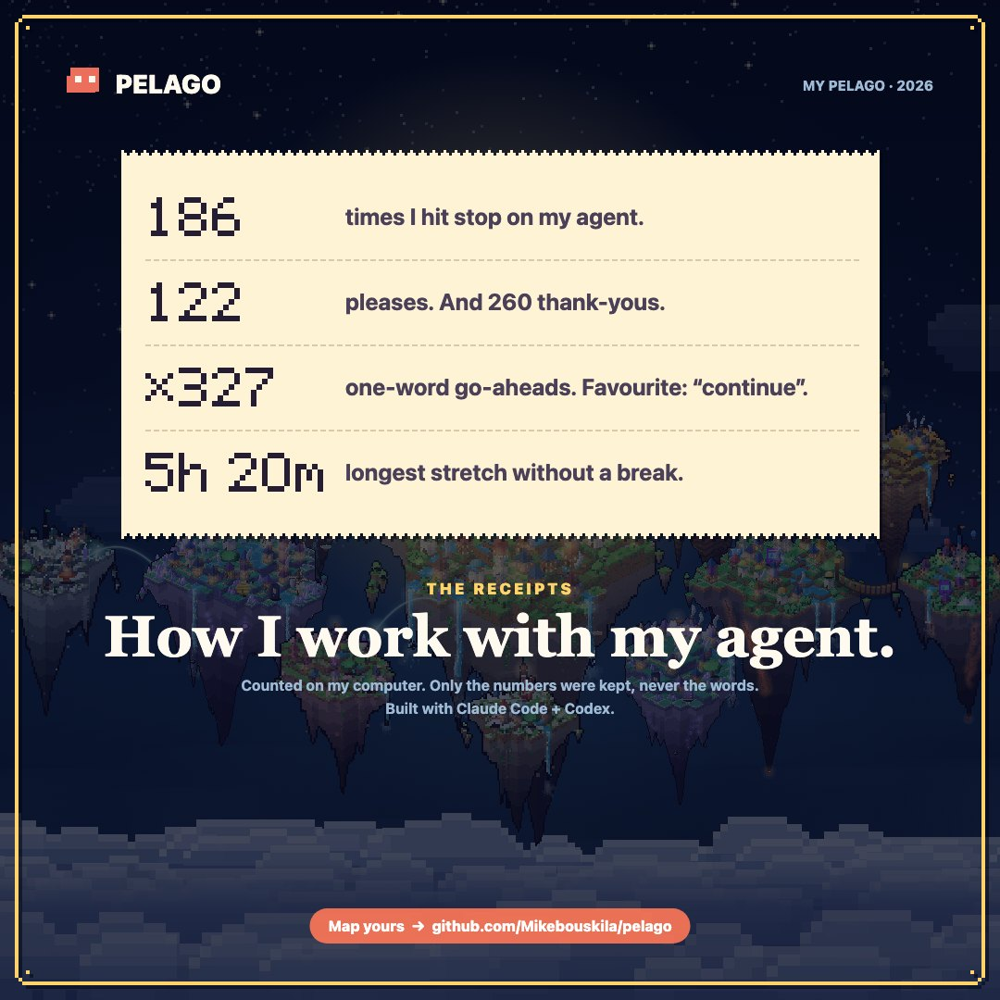
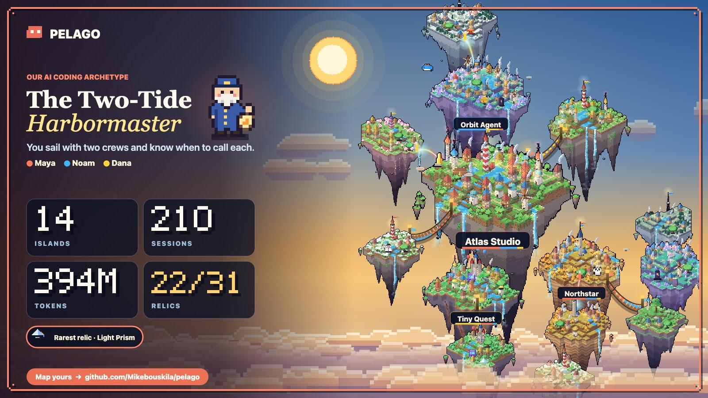

<div align="center">

<a href="https://mikebouskila.github.io/pelago/"><picture><source media="(prefers-reduced-motion: reduce)" srcset="docs/hero.jpg"></picture></a>

# Everything you built with AI became a place.

**Your Claude Code + Codex history as a living pixel-art world. Your AI coding Wrapped, on your machine.**

<a href="https://mikebouskila.github.io/pelago/"></a>&nbsp;&nbsp;&nbsp;<a href="#-get-yours-in-one-prompt"></a>

🔒 Runs locally, reads only two folders (`~/.claude/projects`, `~/.codex/sessions`), uploads nothing.

<sub>[Your story](#-your-story-and-your-card) · [Archetypes](#-which-one-are-you) · [Receipts](#-the-receipts) · [Islands](#️-every-island-is-built-from-your-work) · [Relics](#-31-relics-to-find) · [Teams](#-build-one-world-as-a-team) · [Privacy](#-private-by-design) · [Flags](#️-flags-and-development)</sub>

</div>

<br>

## ⚡ Get yours in one prompt

Open a new session in **Claude Code** or **Codex**, paste one of these, and wait about a minute.

### 🧍 Just me

```text
Build my Pelago world from my local AI coding history.
Clone https://github.com/Mikebouskila/pelago
to ~/.claude/skills/pelago (Codex: ~/.codex/skills/pelago;
if it exists, git pull) and run:
python3 <that folder>/scripts/pelago.py \
  --output ./pelago-world.html --open
It only reads ~/.claude/projects and ~/.codex/sessions.
Then tell me my archetype and to press "Play your story".
Don't quote my prompts.
```

### 👥 With my team

Everyone on the team pastes the same prompt. Each person picks which of their projects to share, one person merges. Your other projects never leave your machine.

```text
Help me build our team's Pelago world from our local AI coding history.

1. Get the Pelago skill from https://github.com/Mikebouskila/pelago:
   - Claude Code: clone it to ~/.claude/skills/pelago
   - Codex: clone it to ~/.codex/skills/pelago
   If that folder already exists, run `git pull` in it instead.
2. Ask me two things: my first name (suggest the one in `git config user.name`),
   and whether I'm the one putting the team world together.
3. Scan my history once with Python 3 (standard library only, nothing to install):
   python3 <skill folder>/scripts/pelago.py --json-output ./pelago-me.json --output ./pelago-world.html --list-projects
   It only reads ~/.claude/projects and ~/.codex/sessions. If you need permission
   to read those two folders, ask me for read access to just them.
   pelago-me.json is my full history and stays on this machine. Never send it.
4. Show me the project list it printed and ask which ones are team projects.
5. Export only those:
   python3 <skill folder>/scripts/pelago.py --input ./pelago-me.json --only "<project>, <project>" --name "<my name>" --json-output ./pelago-team/<my name>.json --output ./pelago-team/<my name>-preview.html
   The preview page shows exactly what I'm sharing.
6. If I'm not putting it together: tell me to send pelago-team/<my name>.json to
   whoever is. It holds only those projects' names and counts, never prompts or code.
7. If I am: ask for our team name, have me drop everyone's .json files into
   ./pelago-team/, then run:
   python3 <skill folder>/scripts/pelago.py --team ./pelago-team --team-name "<team name>" --shared-only --output ./pelago-team-world.html --open
   Then tell me who built what: each person's archetype, how many islands we
   share, and our team archetype. Don't quote any prompts or code.
```

That's it. Everything runs on your machines, nothing is uploaded, and the page works offline.

<details>
<summary><b>Prefer to install it yourself?</b></summary>

<br>

```bash
git clone https://github.com/Mikebouskila/pelago ~/.claude/skills/pelago   # Claude Code
git clone https://github.com/Mikebouskila/pelago ~/.codex/skills/pelago    # Codex
```

Then ask your agent for *"my AI coding wrapped"* or *"my Pelago world"*.

No agent at all? Python 3.9+ is enough:

```bash
python3 scripts/pelago.py --open          # your world
python3 scripts/pelago.py --demo --open   # a sample world, reads nothing
```

</details>

<br>

## 🎬 Your story and your card

<table>
<tr>
<td width="34%" valign="top">

</td>
<td valign="top">

Press **▶ Play your story** for a recap filmed over your own world. The camera flies from the whole archipelago down to single islands and back while it shows:

- your **sessions**, and how many days you spent building
- your **capital**, and how much of everything lives there
- your **tokens**, and how many were cached context
- **the receipts**
- a 24-hour clock of **when you build**
- your **longest streak**, on a calendar
- how you split the work between **Claude Code and Codex**
- your **relics**, rarest first, and the one you're closest to
- your **archetype**, and the two numbers that decided it

It ends on your **card**: Story, Square, X / LinkedIn or GitHub size. Copy it, save it or post it. X, LinkedIn, Bluesky and Threads open with the words written and the picture on your clipboard. The tokens, receipts, relics and archetype slides each have a **Share this** button for a card of just that moment.

**🎞️ The 12-second reel.** Download a video of your islands rising out of the clouds one by one, in the order you founded them, until your archetype lands on top.

</td>
</tr>
</table>

&nbsp;&nbsp;

<br>

## 🧭 Which one are you?



Your archetype is two words, both earned. The title is **what** you build, the first word is **how**. 8 titles × 11 first words = 88 combinations.

| You build… | Title |
|---|---|
| 🏝️ web, the places people arrive at | **Harbormaster** |
| 🌸 mobile apps | **Gardener** |
| 🔭 agents and AI tools | **Stargazer** |
| ⚒️ CLIs and dev tools | **Toolsmith** |
| 📚 data, analysis, notebooks | **Archivist** |
| 🏰 games | **Castle Builder** |
| 🧭 something no category fits | **Wayfinder** |
| 🗺️ three or more kinds, none above 35% | **Cartographer** |

Web and uncategorised work are the most common, so a rarer kind close behind them names you instead.

| First word | When |
|---|---|
| **Midnight** | over a third of your building happens after 10 PM |
| **Dawn** | over a quarter happens between 5 and 9 AM |
| **Weekend** | over 40% happens on weekends |
| **Two-Tide** | Claude Code and Codex each do over a quarter of the work |
| **Unbroken** | you built 30 days in a row |
| **Hive** | over 12% of tool calls send out subagents |
| **Wandering** | 20 or more islands, none holding 40% of the work |
| **Morning**, **Sunlit**, **Twilight** | otherwise, when you build most: 6 AM to noon, noon to 5 PM, or 5 to 10 PM |
| **Steady** | there's no clock to read |

The first match wins, top to bottom. The reveal and the card show the reasons, from your own numbers: *Midnight: 39% of your building happened after 10 PM. Harbormaster: 36% of your work was web.*

<br>

## 🧾 The receipts



How you actually talk to your agent, counted from what you typed:

- how many times you **hit stop** mid-reply
- how many requests said **please**, and how many said **thank you** (or thanks, thx, ty)
- how many were **nothing but a go-ahead**, from a fixed list of 11: continue, go, go on, keep going, yes, y, ok, okay, proceed, do it, next. And which one is your favourite.
- your **longest stretch** in one session without a 20-minute break

They get their own slide in your story and their own card. Only the counts are kept, never the words.

<br clear="right">

<br>

## 🏝️ Every island is built from your work

<div align="center">

</div>

<br>

No two islands are alike, because no two projects are. And they're alive: waterfalls pour, chimneys smoke, windmills turn, lighthouses sweep the night.

| Your work | Becomes |
|---|---|
| **Sessions** | Buildings, one per session (past 48, each stands for several). Longer sessions build taller. |
| **Requests you typed** | Trees, gathered into groves. |
| **Tokens** | Land. The island grows with them and gains a waterfall at 1M, 10M, 100M and 1B. |
| **Tools your agent used** | Forges for shell, workshops for edits, libraries for reading, signal towers for the web, windmills for subagents. |
| **Kind of project** | The biome and the landmark at its heart: a lighthouse on a meadow harbor for web, an observatory among crystals for AI, a clock tower on autumn terraces for data, a radio mast in tundra workshops for CLIs, a pagoda in a blossom village for mobile, a castle with balloons in a candy citadel for games. |
| **Subagents** | Airships circling overhead. |
| **Recency** | Beacons and fireflies on anything you touched in the last three weeks. Snow on islands left alone for two months. |
| **Claude Code / Codex** | Coral and sea-green flags. Built with both? One island, both flags. |
| **When you build** | The sky, painted for your hour: midnight, dawn, morning, golden hour or twilight. The moon fills as you keep showing up, full when you built on each of the last 28 days. |


Your capital sits at the heart. Related projects cluster, rope bridges join projects nested in each other's folders, and on your first visit the islands rise from the clouds along a golden route, in the order you founded them. Filter to just Claude Code or just Codex and the archipelago re-forms around what's left.

<br>

## 💎 31 relics to find

What you built leaves treasures behind. Each relic stands on the island that earned it, glowing in its rarity: Common, Rare, Epic or Legendary. **Click one to see exactly why it's there.**


- 🛠️ **Craft (17).** One for each technology Pelago looks for: Atom Orrery for React, Serpent Idol for Python, Rusted Anvil for Rust, Cargo Whale for Docker, Treasure Chest for payments, Switchboard Totem for MCP, Arcade Cabinet for a game engine, and ten more.
- 📈 **Scale (5).** Golden Obelisk at 100M tokens in one project, **👑 Titan's Crown** at a billion, Great Bell at 100 sessions, Scroll Archive at 500 requests, Marathon Hourglass for a 1,000-message session.
- 🧰 **Tools (5).** Beehive for 100 subagent runs, Star Dish for 200 trips to the web, Lightning Rod for 2,000 shell commands, Master's Hammer for 1,000 edits, Compass Rose for using every kind of tool.
- ⏳ **Crew and time (4).** Twin Arch for a project built with both agents, Ancient Oak for one kept alive 60 days, Seedling of Light for something new this week, Sleeping Snowman for one that's resting.

The **Field Guide** explains every symbol on the map and holds your collection: what each relic takes, where you found it, and the ones you're **closest to unlocking**, like *Lightning Rod, 1.5k of 2k shell commands on Orbit Agent*. Every island names its next relic too.


<br>

## 📱 Made for your phone too

Pinch to zoom, tap an island, play the story in portrait. Everything works on a phone, cards included.


<br>

## 👥 Build one world as a team

**[▶ See a sample team world](https://mikebouskila.github.io/pelago/team.html)**



Use the [team prompt](#-with-my-team) above, or run it by hand:

```bash
# each teammate: see your projects, then export only the team ones
python3 scripts/pelago.py --json-output pelago-me.json --list-projects
python3 scripts/pelago.py --input pelago-me.json --only "api, web app" --name "Maya" --json-output pelago-team/maya.json

# whoever collects the files
python3 scripts/pelago.py --team pelago-team/ --team-name "Our team" --shared-only --open
```

- **You choose what to share.** `--only` keeps just the projects you name. Everything else is dropped before the file is written: names, numbers, even the hours you worked on them. `pelago-me.json` is your full history and stays on your machine.
- **Only what you built together.** `--shared-only` keeps the islands two or more people worked on. Leave it out to also show each person's chosen solo projects.
- **One archipelago.** Projects with the same name (ignoring case and punctuation) become one island, built by everyone who worked on it. Shared islands sit at the heart; solo ones gather on their builder's side.
- **Everyone has a colour.** Roofs, flags and airships wear the colour of whoever built them, in proportion to their share. The strip under each island's name shows the split.
- **Who did what.** Click an island for each builder's share, sessions, requests and tokens there. Filter the map to one person to see just their islands.
- **A crew slide.** The team story introduces each builder with their own archetype, and the card says *our* archetype, with the whole crew on it.

Exports hold only the counts listed under [Privacy](#-private-by-design), never prompts or code. Share them only with people you'd show those project names to.

<br>

## 🔒 Private by design

- Reads only `~/.claude/projects` and `~/.codex/sessions`. Nothing else.
- No network requests, no uploads, no fonts or scripts from anywhere. One HTML file that works offline. Every island is drawn in your browser from the numbers.
- Message text is read in memory, to tell what kind of project it is, which technologies came up and what goes on the receipts, then forgotten.
- The page keeps only aggregates, per project:
  - its name, its kind, and which agents built it
  - first and last day active
  - counts of sessions, messages and requests, and the message count of its 64 biggest sessions
  - input, output and cached token totals, and the names of the models used
  - how many tool calls fell into each kind (shell, edits, reading, web, subagents)
  - activity by hour, weekday and day
  - how often each of a fixed list of 17 technologies came up
  - the receipts: how many times you hit stop, how many requests said please or thanks, how many were a bare go-ahead and which of the 11 was most common, and the longest stretch in minutes
- Showing your screen? Press **Aa** on the map to hide every project name, on the map, in the details, in the story and on the cards. Islands go by their kind instead, like *Meadow harbor*, until you turn names back on.
- Sharing a card? Untick **Show project names** if any are confidential.
- Team worlds never sync anything. Your export leaves your machine only if you send it, and with `--only` it holds just the projects you picked.

Pelago describes a footprint, not a score. A small island isn't a worse project, and nothing ranks you against anyone.

<br>

## 🔢 Every number is real

Pelago counts from your transcripts. It never estimates.

- **Sessions** are conversations. Subagent threads fold into the session that launched them.
- **Requests** are only what you typed. Subagent briefs, system notices and summaries don't count.
- **Tokens** are summed from usage records, each reply billed once.
- Every transcript is read to the last line, however long the session.
- Up to 32 projects become islands, busiest first, and the totals add up those islands.
- Only what's on this computer counts. Claude Code and Codex clean up old transcripts, so totals can be lower than a billing dashboard. The page shows the date your history starts from.
- Claude Code keeps 30 days of history by default. When your world starts that recently, Pelago suggests adding `"cleanupPeriodDays": 365` to `~/.claude/settings.json` so your islands keep growing. It never changes your settings itself.

The test suite pins each of these rules against records shaped like real transcripts.

<br>

## 🎁 Your Wrapped edition

```bash
python3 scripts/pelago.py --year 2026 --open
```

Only what you built in 2026, by your own clock. The story opens on **CLAUDE CODE WRAPPED 2026** (**CODEX WRAPPED** if you used Codex, **AI CODING WRAPPED** if you used both), and the cards carry the same line. A past year is drawn as it stood on December 31, so its islands don't look abandoned. An export made with `--year` keeps its year, and when every teammate exports the same year, the team world is that edition too.

<br>

## 🛠️ Flags and development

```bash
python3 scripts/pelago.py --open                  # your world
python3 scripts/pelago.py --since-days 30 --open  # your month
python3 scripts/pelago.py --demo --open           # a sample world, reads nothing
```

| Flag | What it does |
|---|---|
| `--open` | Open the world in your browser when it's ready. |
| `--output FILE` | Where to write the page (default `pelago-world.html`). |
| `--since-days N` | Only the last N days. |
| `--year YYYY` | A [Wrapped edition](#-your-wrapped-edition): only that calendar year. |
| `--json-output FILE` | Also save the aggregates. |
| `--input FILE` | Build from saved aggregates instead of scanning. |
| `--list-projects` | Print every project found, to choose what to share. |
| `--only "a, b"` | Keep only these projects. Use it before sharing an export. |
| `--name NAME` | Put your name on an export so a team world can credit you. |
| `--team FILES` | Merge teammates' exports (files or a folder) into one world. |
| `--team-name NAME` | What to call the team world. |
| `--shared-only` | In a team world, keep only islands two or more people built. |
| `--demo`, `--demo-team` | A sample world or team world. Reads nothing. |

```bash
python3 -m unittest discover -s tests   # the tests
python3 tools/capture_docs.py           # remake the media in docs/ (Chrome; ffmpeg for GIFs)
```

The generator is `scripts/pelago.py`: Python 3.9+, standard library only. The page is `assets/world-template.html` with `world.css`, `island.js` (the island generator), `relics.js` and `world.js`, inlined into one file at build time.

<div align="center">
<br>

MIT licensed · Made with Claude Code

</div>
