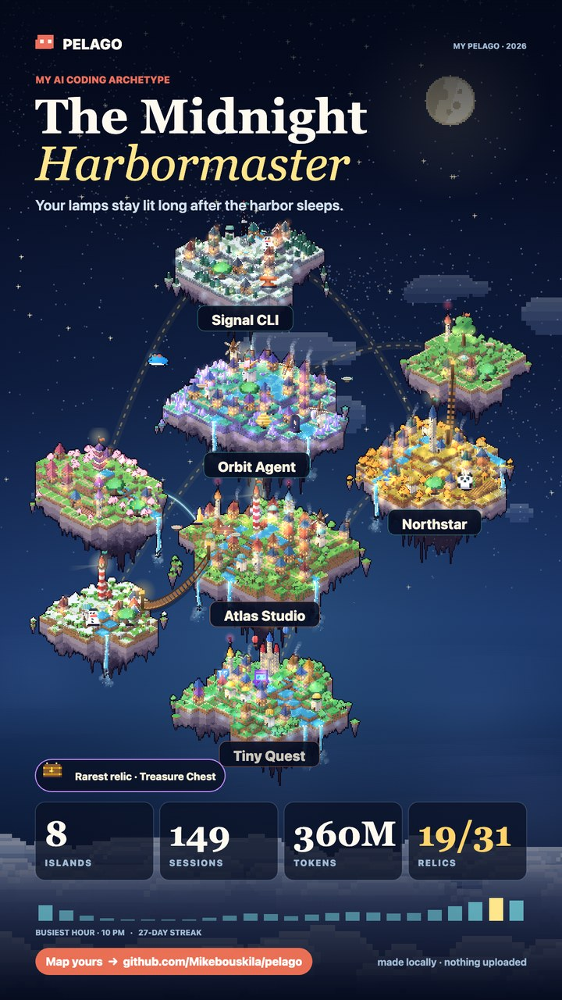
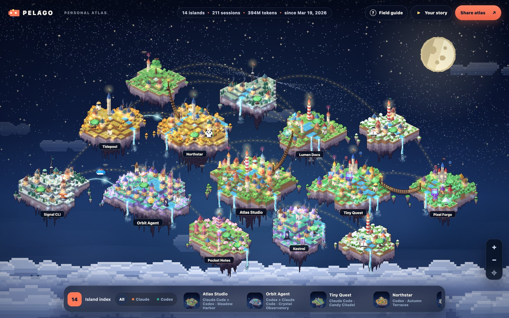
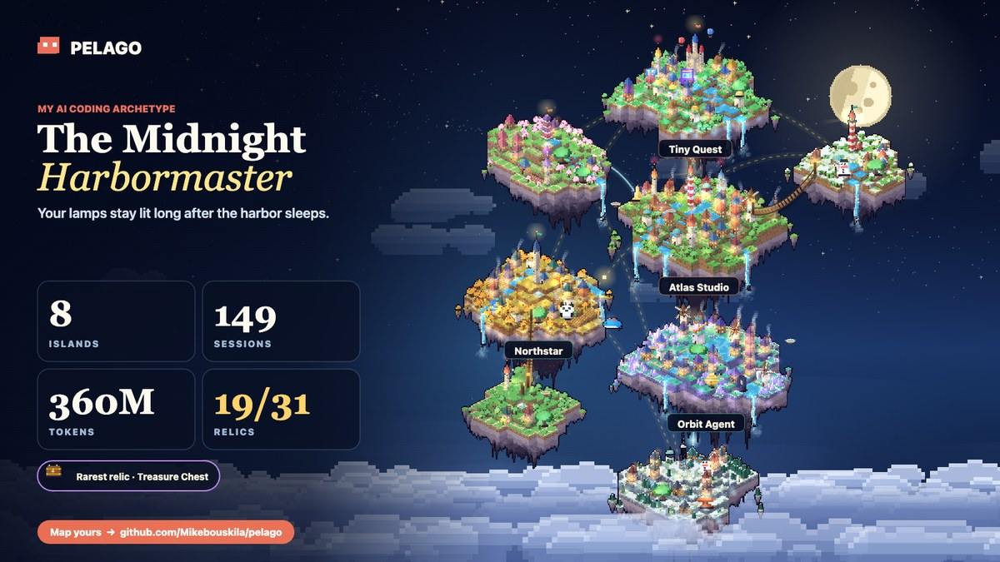

<div align="center">


### Everything you built with AI became a place.

Pelago turns your Claude Code and Codex history into a pixel-art archipelago.<br>
Every project becomes its own island, built from the work itself: a building for every session, a tree for every request, waterfalls from your tokens.

<br>


<br><br>


&nbsp;&nbsp;&nbsp;


<br><br>

**[Get yours in one prompt](#get-yours-in-one-prompt)** · **[Install](#install)** · **[What you get](#what-you-get)** · **[Archetypes](#which-one-are-you)** · **[Privacy](#privacy)**

</div>

---

## Get yours in one prompt

Open a new session in **Claude Code** or **Codex**, paste this, and wait about a minute:

```text
Build my Pelago world from my local AI coding history.

1. Get the Pelago skill from https://github.com/Mikebouskila/pelago:
   - Claude Code: clone it to ~/.claude/skills/pelago
   - Codex: clone it to ~/.codex/skills/pelago
   If that folder already exists, run `git pull` in it instead.
2. Run its generator with Python 3 (standard library only, nothing to install):
   python3 <skill folder>/scripts/pelago.py --output ./pelago-world.html --open
   It only reads ~/.claude/projects and ~/.codex/sessions. If you need permission
   to read those two folders, ask me for read access to just them.
3. When it finishes, tell me in a few lines: my archetype, how many islands,
   my capital island, and how many relics I found (and the rarest one).
   Don't quote or summarise any of my prompts or code.
4. Tell me to open pelago-world.html and press "Play your story".
```

Everything runs on your machine. Nothing is uploaded, and the page works offline.

## Install

**Claude Code** (plugin, recommended):

```bash
/plugin marketplace add Mikebouskila/pelago
/plugin install pelago@pelago
```

Then just ask: *"show me my AI coding wrapped"*. You can also run the skill directly with `/pelago:pelago`.

**Claude Code or Codex** (plain skill):

```bash
git clone https://github.com/Mikebouskila/pelago ~/.claude/skills/pelago   # Claude Code
git clone https://github.com/Mikebouskila/pelago ~/.codex/skills/pelago    # Codex
```

**No agent at all.** Python 3.9+ and the standard library are enough:

```bash
python3 scripts/pelago.py --open
```

Want a look before it reads anything? `python3 scripts/pelago.py --demo --open`

## Every island is built from its own data

No two islands are alike, because no two projects are.


| Your work | Becomes |
|---|---|
| **Tokens** | Land. The island grows, and gains another waterfall, with every 10× more tokens. |
| **Sessions** | Buildings, one per session. Longer sessions build taller. The keep holds your biggest session and flies your agent's flag. |
| **Requests** | Trees. Every prompt you typed plants part of the forest. |
| **Tools your agent used** | Architecture. Smoking forges for shell commands, workshops for edits, domed libraries for reading, signal towers for the web, windmills for subagents. |
| **Output tokens** | Lit windows and lanterns. |
| **Kind of project** | The biome: meadow harbor, crystal observatory, autumn terraces, tundra workshops, blossom village, or candy citadel. |
| **Kind of project, again** | The landmark at the island's heart: a lighthouse for web, an observatory with a telescope for AI, a clock tower for data, a radio mast for CLIs, a pagoda for mobile, a castle with balloons for games, an ancient lantern tree for everything else. |
| **Subagents** | Airships circling the island, more of them the more your agent delegated. |
| **Recency** | Recent islands have a lit beacon, smoking chimneys and fireflies. Islands you haven't touched in two months get snow, and their windows go dark. |

When the same project was worked on by both Claude Code and Codex, it's still one island, and it flies both crews' flags.

### Relics: 31 things to find

What you built leaves treasures on your islands. Each relic stands on the island that earned it, glowing in its rarity colour. Click one to see exactly why you earned it, and open the Field Guide to see every relic and what it takes to unlock it.

| | Examples |
|---|---|
| **Craft** (what you built with) | Atom Orrery for React, Cargo Whale for Docker, Serpent Idol for Python, Rusted Anvil for Rust, Treasure Chest for payments, Switchboard Totem for MCP, Arcade Cabinet for game engines |
| **Scale** | Golden Obelisk at 100M tokens, **Titan's Crown** at 1B, Marathon Hourglass for a 1,000-message session, Great Bell at 100 sessions |
| **Tools** | Beehive for heavy subagent use, Lightning Rod for 2,000 shell commands, Master's Hammer for 1,000 edits, Star Dish for the web, Compass Rose for using every kind of tool |
| **Crew & time** | Twin Arch when Claude Code and Codex built together, Ancient Oak for a 60-day project, Seedling for something new this week, a Sleeping Snowman for one that's resting |

Rarities run Common, Rare, Epic, Legendary. Locked relics show a hint, so you know what to build next. How many have you found?


### One connected world

Your islands aren't scattered; they're an archipelago.

- **Your capital sits at the heart**, and every other island takes the closest free spot around it, biggest first.
- **Families sit together.** An island related to one already placed grows outward from that neighbour.
- **Rope bridges** join projects that live inside one another's folders, like a design spike inside its main repo.
- **Light bridges** arc between projects that share a name, so a family like `atlas-*` reads as one constellation.
- **The golden route** threads every island in the order you founded them, with a lantern sailing along it.

Click any island to see its relics and bridges and jump across. Open the **Field guide** for a full legend of every symbol and your relic collection.

The world is alive: waterfalls pour, smoke drifts, windmill sails turn, flags wave, lighthouse beams sweep. Animation pauses when the tab is hidden and switches off entirely if you prefer reduced motion.

Everything stays pixel-sharp at any size. Islands are drawn from the nearest pixel-art mip and enlarged nearest-neighbour, and the mips are built with a downsampler that keeps outlines instead of blurring them.

The shape, hills, rivers, and layout are seeded from the project, so the same project always grows the same island, and it keeps growing as you work.

## What you get

One HTML file, about 250 KB, that works offline. Open it and press **▶ Play your story**.



| | |
|---|---|
| **The map** | Your whole archipelago. Drag and zoom, then click any island to see exactly what it was built from. Coral flags mean Claude Code, sea-green flags mean Codex. |
| **The story** | A nine-slide recap filmed over your own world: the camera flies from your whole archipelago to your capital and back while it shows your sessions, tokens, a 24-hour clock of when you build, a calendar of your longest streak, your crew, your relics and your archetype. |
| **The archetype** | A title earned from your real rhythm and project mix, like *The Midnight Harbormaster*. |
| **The cards** | Story (1080×1920), Square, X/LinkedIn, and GitHub formats. Download, copy to clipboard, share natively on mobile, or post to X in one click. |



## Which one are you?

The noun comes from the kind of project you spend the most time on:

| Realm | You build… | Title |
|---|---|---|
| 🏝️ Harbor | web, mobile, and everything else people arrive at | **Harbormaster** |
| 🔭 Observatory | agents, AI tools, CLIs | **Stargazer** |
| 📚 Living archive | data, analysis, notebooks | **Archivist** |
| 🏰 Citadel | games | **Castle Builder** |

The adjective comes from when and how you build: **Midnight** (a lot after 10 PM), **Dawn** (early mornings), **Weekend**, **Two-Tide** (real work split between Claude Code and Codex), **Wandering** (many projects), **Devoted** (one project holds most of it), or **Steady**.

There are 28 combinations. Post yours with **#pelago**.

Pelago describes a footprint, not a score. A small island is not a worse project. Nothing ranks you against anyone else.

## Every number is real

Pelago counts from your transcripts, not estimates:

- **Sessions** are conversations. Subagent threads (Claude Code and Codex) fold into the session that launched them, and metadata files are never counted.
- **Requests** are only what you typed. Subagent briefs, system notices, compaction summaries and interruptions are excluded.
- **Messages** are real turns (yours, the agent's, and its tool calls), each reply counted once even when it is split across records.
- **Tokens** are summed from usage records, each reply billed once. The story tells you how much of it was cached context being re-read.
- Every line of every transcript is read, however large.
- Only what is on this computer counts. Claude Code and Codex clean up old transcripts over time, and sessions from other machines or the cloud are not here, so totals can be lower than a billing dashboard. The page shows the date your history starts from.

The test suite pins each of these rules against records shaped like real transcripts.

## Useful flags

```bash
python3 scripts/pelago.py --since-days 30 --open     # your month
python3 scripts/pelago.py --since-days 365 --open    # your year
python3 scripts/pelago.py --json-output pelago.json  # keep the aggregates
python3 scripts/pelago.py --input pelago.json        # rebuild from them
```

## Privacy

- Pelago reads only `~/.claude/projects` and `~/.codex/sessions`.
- Nothing is uploaded, and there are no network requests. Every island is drawn in your browser from the numbers.
- Message text is read in memory only to guess each project's realm. It is never written anywhere.
- The output contains only aggregates: project names, dates, counts (sessions, requests, messages, per-session message counts), token totals, tool-category counts, model family names, hour/weekday totals, which islands are related (by id, never by path), and how often each of 17 well-known technologies came up (a fixed list like React, Python or Docker).
- Cards show project names by default. If you're about to share and some names are confidential, untick **Show project names**.

Worktrees and subagent transcripts fold back into the repository they belong to. Throwaway checkouts in `/tmp` become a single island called *Scratch waters*.

## Development

```bash
python3 -m unittest discover -s tests -v
python3 scripts/pelago.py --demo --output /tmp/pelago-world.html
```

The generator is `scripts/pelago.py`, which uses only the standard library. The page is `assets/world-template.html`, `world.css`, `island.js` (the procedural island generator), and `world.js`, all inlined into a single file at build time.

MIT licensed.
